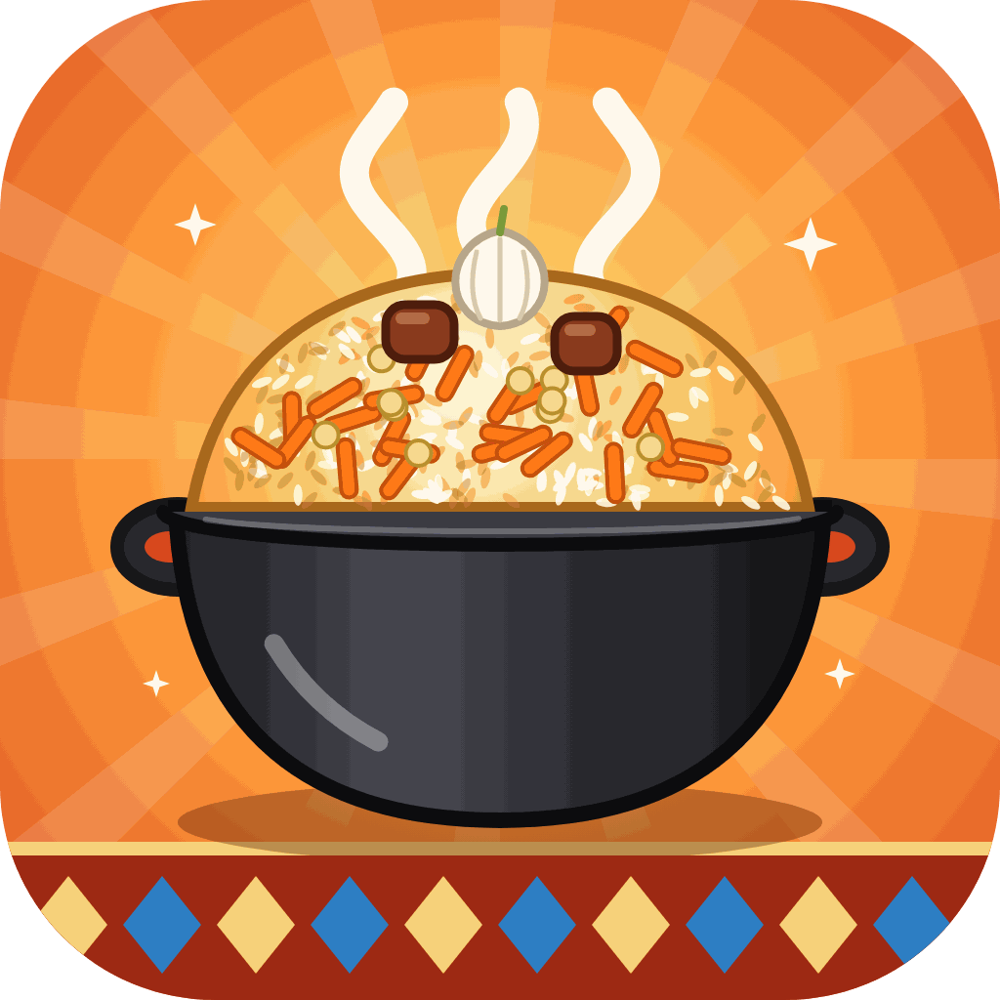

# Osh markazi — 3D onlayn o'yin (Andijon)

Andijonda o'z oshxonangizni ochib, uni osh markaziga, keyin kafe va restoranga aylantiradigan 3D multiplayer o'yin.
Grafikasi Roblox uslubida: yorqin va sodda, lekin odamlar yumaloq, to'rtburchak emas.

Sinov uchun manzil oxiriga qo'shish mumkin: `?event=navruz` (bayram bezaklari), `?time=night` yoki `?time=day` (kecha / kunduz), `?intro` (boshidagi videoni qayta ko'rish).

## Fayllar (5 ta kod fayli)

| Fayl | Nima qiladi |
|---|---|
| `index.html` | Ekran: boshlash oynasi, tugmalar, joystik, menyu, chat |
| `game.js` | Asosiy o'yin: personaj, yurish/yugurish/o'tirish, mashina haydash, kamera, mijozlar, ishchilar, to'y buyurtmalari, multiplayer, ovozli boshlang'ich video, menyu |
| `world.js` | Shahar va binolar: yo'llar, hovlilar, maydon, bozor, park, 3 qavatli osh markazi/kafe/restoran ichi, Damas |
| `economy.js` | Narxlar, darajalar, bozor narxlari, to'y buyurtmalari, bayramlar |
| `server.js` | Multiplayer server (o'yinchilar, chat, sheriklik, pul, saqlash) |

Qo'shimcha (kod emas): `package.json` va `render.yaml` server sozlamasi, `.github/workflows/build.yml` APK, Windows dasturi va sahifani yig'adi, `icon.png` o'yin ikonkasi, `lib/` esa Three.js kutubxonasi (internetsiz ham ochilishi uchun). Model va ovoz fayllari yo'q: hammasi kod bilan yasalgan.

## Kompyuterda ishga tushirish

1. [Node.js](https://nodejs.org) o'rnating (18 yoki yangiroq).
2. Papkada: `npm install`, keyin `npm start`.
3. Brauzerda oching: `http://localhost:3000`. Ikkinchi oynada ham ochsangiz, multiplayer ko'rinadi.
   Bir xil Wi-Fi'dagi telefondan ham kirish mumkin: `http://KOMPYUTER-IP:3000`.

## GitHub'ga yuklash

1. GitHub'da yangi repozitoriy oching (masalan `osh-markazi`).
2. Shu papkadagi fayllarni yuklang (**Add file → Upload files**). `node_modules` va `data.json` ni yuklamang.

## Internetda multiplayer (bepul)

1. Yuqoridagi tugmani bosing, [render.com](https://render.com) ga GitHub orqali kiring va **Apply** ni bosing.
2. Berilgan manzil (masalan `https://osh-markazi.onrender.com`) ni do'stlaringizga yuboring. O'yin va server bitta manzilda ishlaydi.
3. **Ma'lumotlar o'chib ketmasligi uchun** (bepul tarifda server qayta ishga tushganda fayl o'chadi):
   GitHub'da **Settings → Developer settings → Fine-grained tokens** orqali shu repozitoriyga *Contents: Read and write* huquqli token yarating.
   Render'da `GITHUB_TOKEN` = shu token, `DATA_REPO` = `Abduvahobb/My_Plov` deb yozing. Server o'yinchilar ma'lumotini har 20 soniyada `data` shoxchasiga saqlaydi.

> Faqat GitHub Pages'da ochilsa, o'yin oflayn (bir kishilik) rejimda ishlaydi.
> Pages'da ham multiplayer kerak bo'lsa, `game.js` tepasidagi `DEFAULT_SERVER` ga server manzilini yozing (`wss://...`).

## Yuklab olish va o'ynash

- **Telefon (Android APK):** https://github.com/Abduvahobb/My_Plov/releases/latest/download/OshMarkazi.apk
- **Kompyuter (Windows):** https://github.com/Abduvahobb/My_Plov/releases/latest/download/OshMarkazi-Windows.exe (o'rnatish shart emas, yuklab olib ochasiz)
- **Brauzerda o'ynash:** https://abduvahobb.github.io/My_Plov/

Bularning hammasini GitHub o'zi yig'adi (`.github/workflows/build.yml`): har safar `main` ga yangi narsa yuklanganda yangi versiya avtomatik chiqadi.
Multiplayer uchun serverni ishga tushirib (pastga qarang), **Settings → Secrets and variables → Actions → Variables** bo'limida `SERVER_URL` = `wss://...` qo'shing.

## Akkaunt (PIN)

Boshlash oynasida ismingiz bilan birga 4–6 raqamli PIN yozsangiz, ism sizniki bo'lib qoladi: boshqa telefon yoki kompyuterdan shu ism va PIN bilan kirib, o'z pulingiz va oshxonangizni davom ettirasiz. PIN serverda shifrlangan holda saqlanadi.

## Boshqaruv

- **Telefon:** chap tomonda joystik, o'ng tomonda barmoq bilan kamera. Tugmalar: Yugurish, Sakrash va vaziyatga qarab o'zgaradigan harakat tugmasi (Kirish, Pishirish, Osh berish, O'tirish, Qavatga chiqish, Damasga o'tirish, Masalliq olish...).
- **Kompyuter:** W A S D bilan yurish, Shift bilan yugurish, Space bilan sakrash, E harakat tugmasi. Sichqoncha bilan kamera, M yoki Tab bilan Boshqaruv menyusi, Enter bilan chat.
- **Yuqoridagi tugmalar:** 💬 chat, ♫ o'yin musiqasi, 🔊 ovoz.
- **Mashina:** oldinga — gaz, orqaga — tormoz/orqaga yurish, chap/o'ng — rul.

## O'yinda nimalar bor

**1-bosqich**
- **Ovozli boshlang'ich video:** boy odam qahramonni limuzindan itarib yuboradi. Musiqa, motor va yiqilish ovozlari, gaplar.
- **Andijon shahri (Roblox uslubida):** yo'llar, chiroqlar, hovlilar, maydon, bozor, ko'lli park, bog', futbol maydoni, ko'cha harakati.
- **Yumaloq personajlar:** erkak yoki ayol, oddiy kiyimda. Yuradi, yuguradi, sakraydi, stulga o'tiradi.
- **Mijozlar:** uydan chiqib piyoda yoki mashinadan tushib keladi, o'tiradi, buyurtma beradi, yeb pul to'laydi, uyiga qaytadi.
- **Boshqaruv menyusi, ishchilar, multiplayer va sheriklik** (har bir sherik to'liq pul oladi).

**2-bosqich**
- **3 qavatli bino.** 1-qavatda zal va chap qanotda 4 ta xona (Xonalar kuchaytirishi bilan ochiladi):
  - Ombor: masalliq saqlanadi, darajasi oshgan sari sig'imi kattalashadi.
  - Sovutgich: masalliq 10% arzon.
  - Ishchilar xonasi: ishchilar 30% tez.
  - Hojatxona: mijozlar 15 soniya ko'proq kutadi.
- **2-qavat VIP zal:** u yerdagi mijozlar 2 baravar to'laydi. **3-qavat banket zali:** to'ylar uchun. Mijozlar va ofitsiant zinapoyadan chiqib-tushadi.
- **Kafe va restoranning alohida zali:** kafe tandir va somsa, firuza bezak bilan; restoran mangal va shashlik, qizil-oltin bezak bilan.
- **Bozor narxlari:** ovqat tayyorlash uchun masalliq kerak. Narxi har bir necha daqiqada o'zgaradi, bozorga borib olsangiz 15% arzon.
- **To'y buyurtmalari:**
  - Damas bilan yetkazish: tayyorlab, Damasga yuklab, pushti nurdagi to'yxonaga haydaysiz.
  - Banket zalida to'y: 16 ta mehmon keladi, oxirida katta bonus beriladi.
- **Mashina haydash:** har bir biznesning o'z Damasi bor, boshqa o'yinchilar ham ko'radi.
- **Mahalla reytingi:** eng ko'p daromad qilgan biznes binosi tepasida toj turadi.
- **Bayramlar:** Navro'z, Mustaqillik, Yangi yil, Hayit va 9-may kunlari ko'chalar bayroqchalar bilan bezatiladi, mijozlar ko'payadi. Har juma "osh kuni".
- **Telefon uchun APK, Windows dasturi va brauzer sahifasi:** GitHub o'zi yig'adi.

**3-bosqich**
- **Multfilm uslubi:** yumaloq devorlar, uylar, panjaralar va mebel, yumshoq "toon" yorug'lik.
- **Yangi mashinalar:** sedan, hatchback, jip, sariq taksi va limuzin; tunda faralar yonadi. Damas ham yangilandi.
- **Kun va tun:** 20 daqiqalik sikl (hamma o'yinchida bir xil). Kechasi chiroqlar, derazalar, yulduzlar va oy yonadi.
- **Har biznesning o'z tashqi ko'rinishi:** oshxona yog'och ustunli, kafe vitrina va soyabonli stollar bilan, restoran gumbaz, ustunlar va qizil gilam bilan. Ikki qavat bo'lsa balkon chiqadi.
- **Bezak darajalari ko'rinadi:** koshin naqshlar, so'zana, osma chiroqlar, gilam yo'lak va oltin ramkalar; tashqarida gulzorlar va chiroqlar gulchambari.
- **Eshiklar ochilib-yopiladi**, mijozlar tezroq keladi (yaqin uylardan, ko'proq mashinada).
- **Mashinalar odamlarni va bir-birini ko'radi:** oldida kimdir bo'lsa sekinlashib to'xtaydi. Damas boshqa mashinalarga urilib o'tib ketmaydi.
- **Do'stingizning oshxonasi bo'sh qolmaydi:** egasi o'yinda bo'lmasa ham mehmonlar ichkarida mijozlarni ko'radi.
- **Pulni server hisoblaydi** (aldash mumkin emas), **PIN bilan akkaunt**, ma'lumotlarni GitHub'da saqlash.
- **Ovozlar:** qadam tovushi, olov chirsillashi, odamlar shovqini, eshik, o'yin ichida sokin musiqa, multfilmdagidek gapirish ovozi.
- **Boshidagi video bir marta** ko'rsatiladi (qayta ko'rish tugmasi bor). Telefonda chat yig'iladigan bo'ldi, xabarlar pastga ko'chdi.
- **Sekin telefonda** o'yin o'zi soyalarni o'chirib tezlashadi.
- **Yangi ikonka** (qozondagi osh) va kichikroq Windows dasturi.

## Keyingi g'oyalar

- O'yinchilar bir-biriga pul o'tkazishi va oila qurishi
- Damas bilan oddiy mijozlarga ham yetkazib berish
- Haqiqiy yozib olingan musiqa
- Ob-havo: yomg'ir va qor

## Davom ettirish

Yangi narsa qo'shmoqchi bo'lsangiz, Claude'ga shu fayllarni (yoki GitHub manzilini) bering va nima qo'shishni yozing. Ish shu joydan davom etadi.
